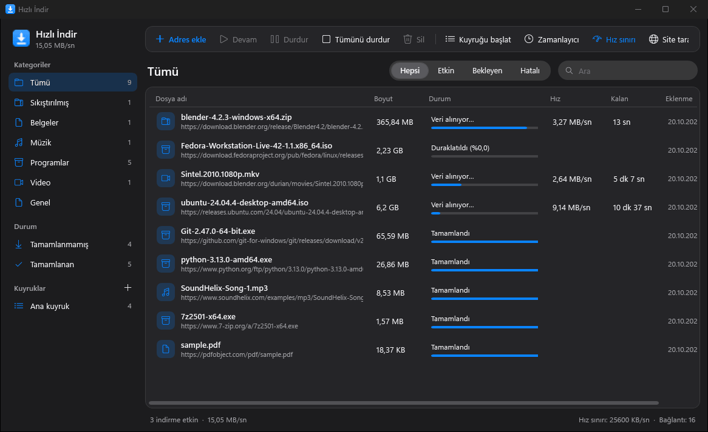
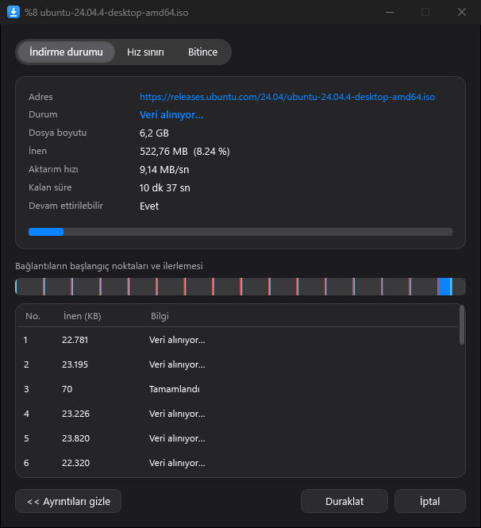
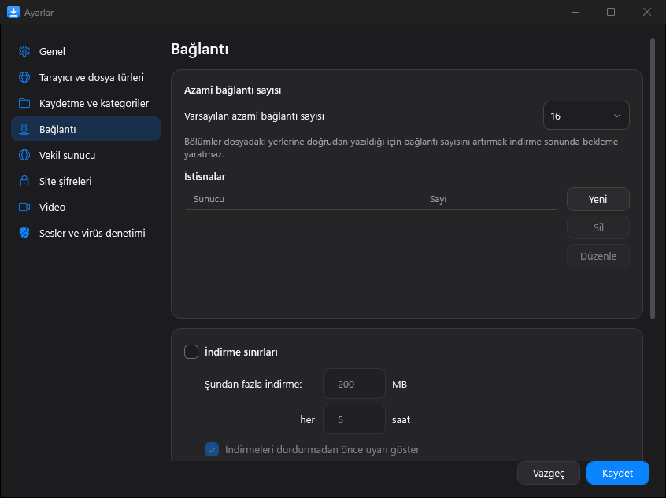

# Hızlı İndir

Windows için çok bağlantılı indirme yöneticisi. Kullanımı IDM'e benzer: adres eklersin, bilgi penceresi açılır, indirme bölümlere ayrılarak başlar, tarayıcıdaki indirmeler ve videolar uygulamaya düşer. Kod sıfırdan yazıldı; IDM'den kod, simge ya da metin alınmadı.

Yazar: Kutay Kılıç

## Ekran görüntüleri



Ana pencerede indirmeler kategoriye ve duruma göre listelenir. Aşağıda solda bir indirmenin ilerleme penceresi var; alttaki şeritte her bağlantının dosyanın hangi bölümünü indirdiği görünüyor. Sağda ayarların Bağlantı bölümü.

<p>
  
  
</p>

## Neler var

- Tek dosyayı 1 ile 32 arasında bağlantıyla indirme (varsayılan 16). Bir bölüm bitince en büyük kalan bölüm ikiye bölünür, böylece son saniyelerde tek bağlantıya düşülmez.
- Sunucu bölümlü indirmeyi desteklemiyorsa otomatik olarak tek bağlantıya geçer. Sunucu ek bağlantıları reddederse kalan bağlantılarla devam eder.
- Kaldığı yerden devam. Bölüm durumu `indirmeler.json` içinde tutulur; dosya sunucuda değişmişse (boyut ya da ETag farklıysa) baştan başlar.
- Kuyruklar, zamanlayıcı, eşzamanlı indirme sınırı, bitince kapat / uyku / hazırda beklet.
- Genel ve indirme başına hız sınırı, belirli sürede en fazla şu kadar indir kotası.
- Kategoriler ve klasör kuralları. İlk açılışta IDM'in klasör ayarları okunup aktarılır.
- Pano izleme, toplu indirme (joker desen), site tarayıcı, vekil sunucu, site şifreleri, bitince ses ve virüs denetimi.
- Chrome ve Edge eklentisi: indirmeleri yakalar, çerez, yönlendiren ve tarayıcı kimliğiyle uygulamaya aktarır. Videoların üzerinde "Bu videoyu indir" düğmesi çıkar.
- YouTube ve diğer video siteleri için yt-dlp ve ffmpeg kullanılır. İkisi de ilk kullanımda indirilir ve günde bir kez güncellenir.
- Torrent: `.torrent` dosyası ya da magnet bağlantısıyla indirme. Hangi dosyaların ineceğini seçersin, duraklatıp devam ettirebilirsin, uygulama kapanıp açılınca kaldığı yerden sürer. Motor olarak MonoTorrent kullanılır. Torrent içindeki dosya yolları indirmeden önce denetlenir; `..`, sürücü harfi ya da Windows'un ayrılmış adlarını içeren bir torrent hiç açılmaz.
- Windows temasına uyan açık ve koyu görünüm, Mica arka plan, Türkçe arayüz, bildirim alanı simgesi.

## İndirme bitince bekleme olmaması

IDM gibi araçlar her bağlantının verisini ayrı geçici dosyaya yazar, indirme bitince bu parçaları tek dosyada birleştirir. Büyük dosyada bu birleştirme dakikalar sürebilir; bağlantı sayısını 1'e düşürmenin sebebi genellikle budur.

Hızlı İndir'de birleştirme adımı yok:

1. İndirme başlarken hedef klasörde dosyanın tam boyutunda bir `.hizli` dosyası ayrılır.
2. Her bağlantı kendi bölümünü doğrudan bu dosyada kendi konumuna yazar.
3. Son bayt yazıldığında yapılan tek iş dosyanın adını değiştirmektir.

Test bilgisayarındaki ölçümlerde son bayttan "Tamamlandı" durumuna geçiş 1 GB'lık dosyalarda 0,6 ile 1,5 milisaniye arasında sürdü. Bu yüzden bağlantı sayısını düşürmeye gerek yok, 16 bağlantıyla da indirme biter bitmez dosya hazır olur.

## Kurulum

Gerekenler: Windows 10 veya 11, .NET 8 Desktop Runtime.

**Hazır sürüm:** [Releases](https://github.com/kutaykilicai/hizli-indir/releases) sayfasındaki zip'i indir, bir klasöre aç ve `HizliIndir.exe`'yi çalıştır. Tarayıcı eklentisi zip'in içindeki `extension` klasöründe.

**Kaynaktan derleme:**

```powershell
git clone https://github.com/kutaykilicai/hizli-indir.git
cd hizli-indir
powershell -ExecutionPolicy Bypass -File .\build.ps1 -Install
```

Betik uygulamayı `%LOCALAPPDATA%\Programs\HizliIndir` klasörüne kurar ve masaüstüne "Hızlı İndir" kısayolu ekler. Uygulama ilk açılışta tarayıcı köprüsünü (Native Messaging) Chrome, Edge, Brave ve Chromium için kullanıcı kayıt defterine işler. Yönetici izni gerekmez.

## Tarayıcı eklentisi

1. Chrome'da `chrome://extensions` adresini aç (Edge'de `edge://extensions`).
2. Sağ üstten Geliştirici modunu aç.
3. "Paketlenmemiş öğe yükle" düğmesine bas ve `%LOCALAPPDATA%\Programs\HizliIndir\extension` klasörünü seç.
4. IDM eklentisi de yüklüyse onu kapat, yoksa aynı indirme iki program tarafından yakalanır.

Eklentinin kimliği sabittir (`ggkjdampbopnagbdllenngdcjbhlfpla`), köprü yalnızca bu kimliğe izin verir.

Eklentinin yaptıkları:

- Ayarlardaki dosya türlerinden biri indirilirken Chrome'un indirmesini iptal eder ve adresi çerezler, yönlendiren sayfa, tarayıcı kimliği ve varsa POST gövdesiyle birlikte uygulamaya gönderir.
- Uygulama kapalıysa köprü uygulamayı başlatır. Uygulamaya ulaşılamazsa indirme tarayıcıda devam eder.
- Alt tuşuna basılı tutarak tıklanan bağlantı tarayıcıda kalır.
- Araç çubuğu simgesinden eklenti tamamen ya da yalnızca o site için kapatılabilir. Sayfada bulunan video akışları (HLS, DASH, doğrudan dosya) burada listelenir.
- Sağ tık menüsü: bağlantıyı indir, sayfadaki tüm bağlantıları indir, seçili alandaki bağlantıları indir.
- Video oynarken üstte mavi bir düğme çıkar. Tıklayınca kalite seçilir (en iyi, 4K, 1440p, 1080p, 720p, 480p, MP3, M4A). Alt ile tıklarsan varsayılan kaliteyle hemen başlar.

## Torrent

Torrent eklemenin dört yolu var:

- Araç çubuğundaki **Torrent** düğmesiyle bir `.torrent` dosyası seç.
- `.torrent` dosyasını ana pencereye sürükle.
- Magnet bağlantısını **Adres ekle** penceresine yapıştır.
- Eklenti yüklüyse sayfadaki magnet bağlantısına ya da `.torrent` indirmesine tıkla. Alt tuşu basılıyken tıklarsan tarayıcı kendisi açar.

Magnet bağlantısında önce dosya listesi eşlerden istenir; bu birkaç saniye ile birkaç dakika arasında sürebilir. Liste gelince dosyaları seçip indirmeyi başlatırsın. İndirme bitince paylaşım varsayılan olarak durur, istersen Ayarlar > Torrent'ten açık bırakabilirsin. Genel hız sınırı torrentlere de uygulanır.

Hızlı İndir dosya ilişkilendirmesi kurmaz ve `magnet:` bağlantılarını kendiliğinden üstlenmez. Torrent kopyaları ve kaldığı yerden devam bilgisi `%LOCALAPPDATA%\HizliIndir\torrent` altında tutulur. Yalnızca indirme hakkın olan içerikleri indir; Hızlı İndir herhangi bir torrent sitesi ya da arama hizmetiyle bağlantılı değildir.

## Varsayılan klasörler

İndirmeler varsayılan olarak `%USERPROFILE%\Downloads` altına, kategoriye göre alt klasörlere iner. Yarım kalan `.hizli` dosyaları `%USERPROFILE%\Downloads\HizliIndir-Gecici` klasöründe tutulur. İkisi de Ayarlar > Kaydetme bölümünden değiştirilebilir; seçtiğin yollar `ayarlar.json` dosyasına yazılır ve güncellemelerde korunur.

## Proje yapısı

```
src/HizliIndir/          WPF uygulaması
  Core/                  indirme motoru, kuyruklar, ayarlar, köprü sunucusu
  UI/                    pencereler
  Themes/                açık/koyu tema ve denetim stilleri
src/HizliIndir.Host/     tarayıcı ile uygulama arasındaki küçük köprü programı
tests/HizliIndir.Tests/  torrent ayrıştırma, yol denetimi ve motor testleri (xUnit)
extension/               Chrome/Edge eklentisi (Manifest V3)
build.ps1                derleme ve kurulum betiği
```

Veriler `%LOCALAPPDATA%\HizliIndir` altında durur: `ayarlar.json`, `indirmeler.json`, `kuyruklar.json`, `gunluk.txt` ve `tools` klasöründe yt-dlp, ffmpeg, deno.

## Testler

`dotnet test tests/HizliIndir.Tests` çevrimdışı testleri çalıştırır. Gerçek ağda kısa motor denemesi için `HIZLI_AG_TESTI=1` ortam değişkenini ver; bu deneme Ubuntu sunucu kalıbının torrentini birkaç yüz KB indirip durdurur ve magnet bağlantısından dosya listesini ister.

## Bilinen eksikler

- Eklenti Chrome Web Mağazası'nda değil, elle yüklenmesi gerekiyor.
- FTP ve çevirmeli bağlantı desteği yok.
- Ayarlarda kategori değiştirildiğinde ana penceredeki kategori listesi uygulama yeniden açılınca güncellenir.

## Uyarı

Hızlı İndir bağımsız bir projedir, Internet Download Manager ya da Tonec ile bağı yoktur. Video indirme yt-dlp ile yapılır; indirdiğin içeriğin telif haklarına ve sitelerin kullanım koşullarına uymak senin sorumluluğundadır.

## Lisans

MIT. Ayrıntı için `LICENSE` dosyasına bak. Torrent motoru [MonoTorrent](https://github.com/alanmcgovern/monotorrent) (MIT) NuGet paketi olarak kullanılır.

## English

Hızlı İndir is a multi-connection download manager for Windows (WPF, .NET 8) with a Chrome/Edge extension and video downloads through yt-dlp and ffmpeg. Each connection writes straight into a preallocated file, so there is no merge step when a download finishes.

- **Install:** download the zip from Releases and run `HizliIndir.exe`, or build with `powershell -ExecutionPolicy Bypass -File .\build.ps1 -Install` (needs the .NET 8 SDK).
- **Extension:** load the `extension` folder as an unpacked extension in `chrome://extensions` or `edge://extensions`.
- **Defaults:** downloads go to `%USERPROFILE%\Downloads`, partial files to `Downloads\HizliIndir-Gecici`; both can be changed in Settings.
- **Torrents:** open a `.torrent` file or paste a magnet link, pick the files, pause and resume. Built on MonoTorrent (MIT). Unsafe file paths inside a torrent are rejected before anything is written.
- **Disclaimer:** not affiliated with Internet Download Manager. Respect copyright and site terms when downloading videos.
- **License:** MIT.
